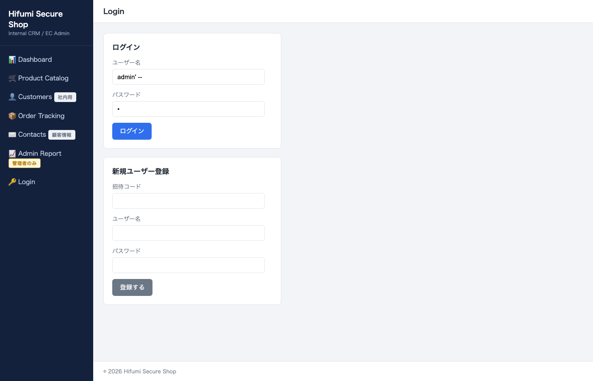
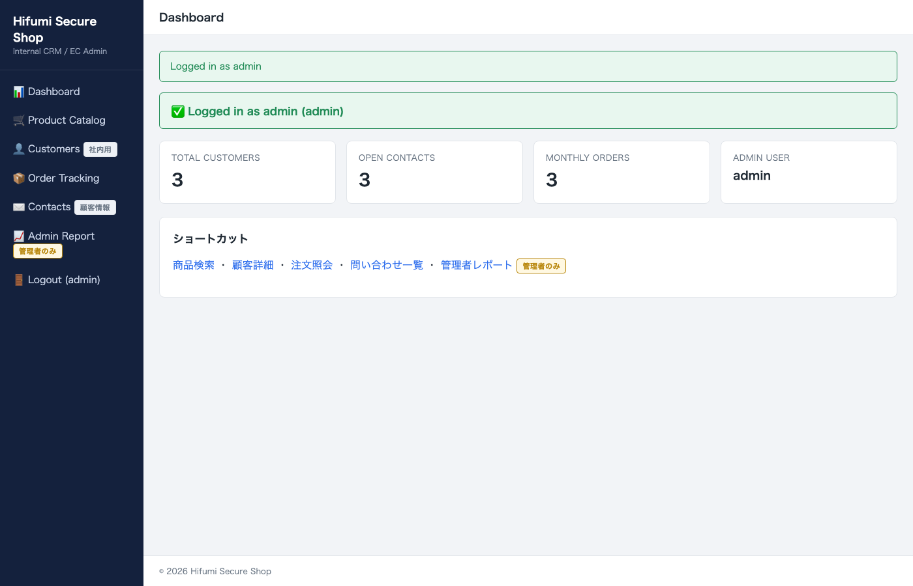
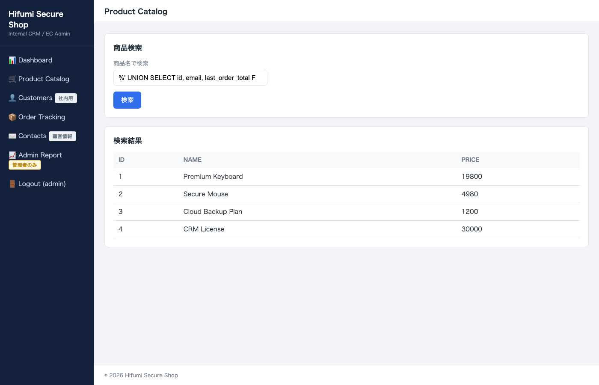
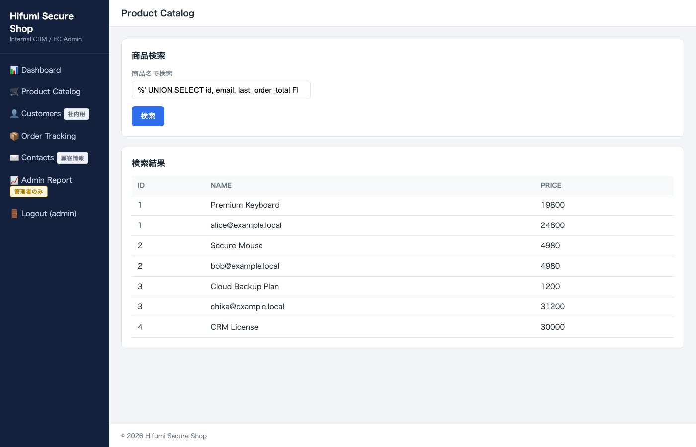
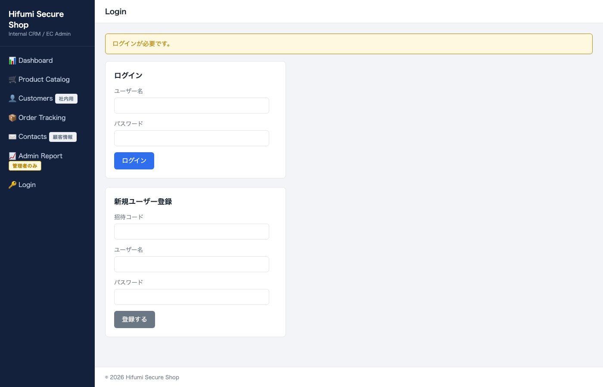
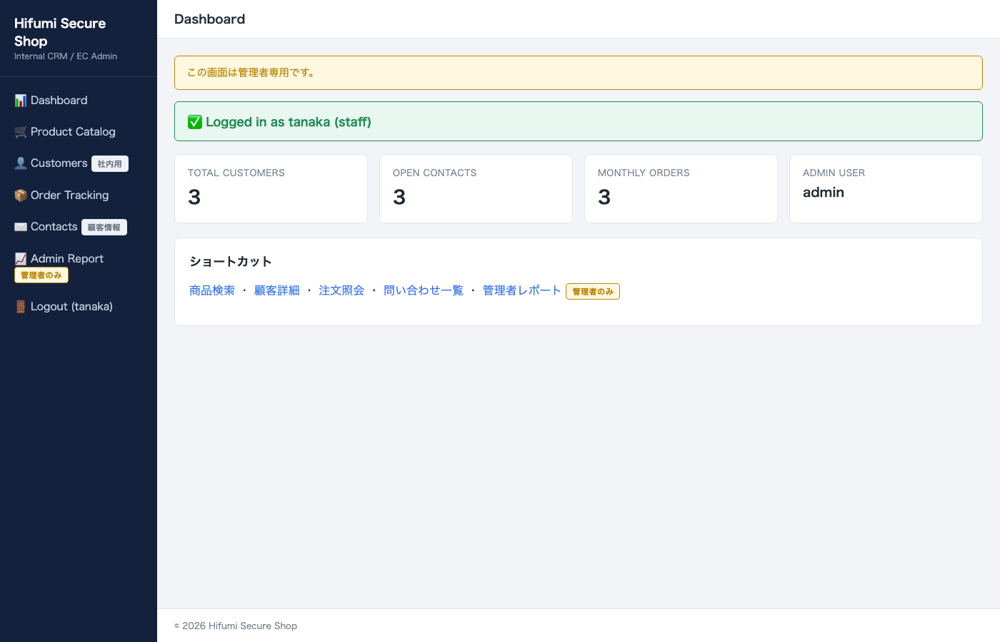
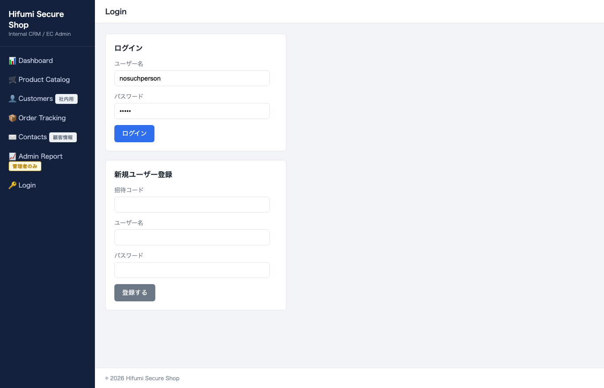
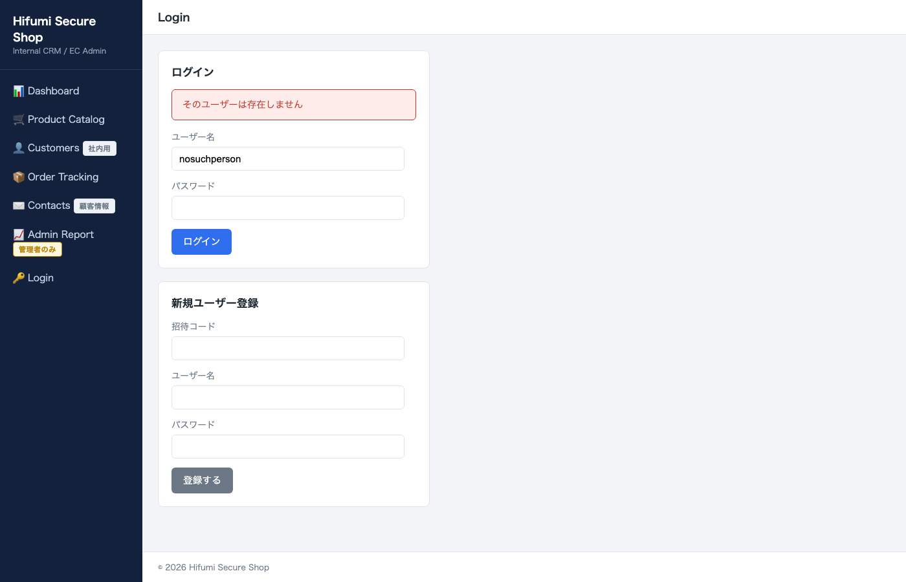
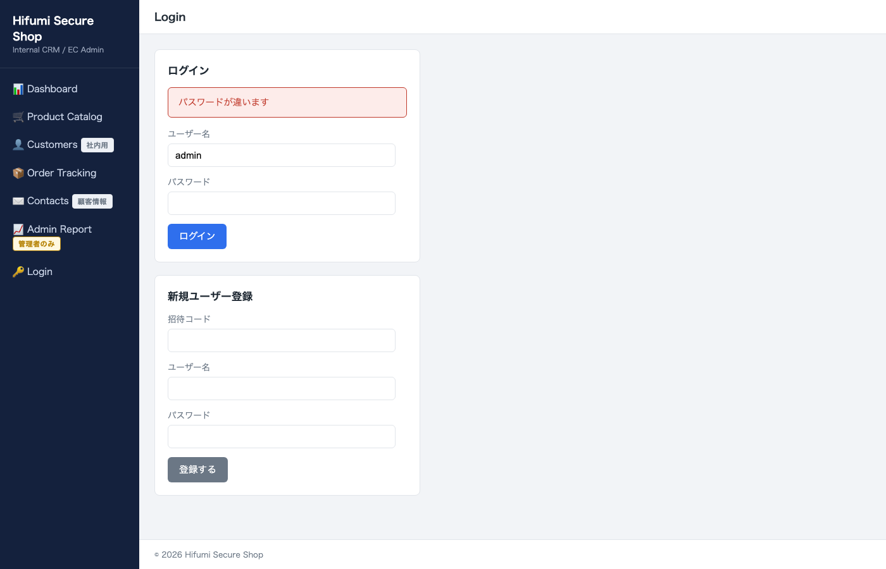

# SQLインジェクション講座

## 攻撃の仕組みから対策まで

<br>

2026年7月　前半（50分）

---

## 今日の 100 分

- 前半：50 分　─→　基本原理を分解する
- 休憩：10 分
- 後半：50 分　─→　攻撃者視点で通しで見る

<br>

今日は「読ませるスライド」ではなく、**講師の実演を見る講義**です。

---

## 注意事項（最初に必ず）

<div class="danger">

- 本講義は **学習目的** です
- 実演対象は **講義用ローカル教材サイトのみ**
- 許可のない実在システムへの試行は **禁止**
- 今日扱う内容は **防御を理解するため** に学びます

</div>

---

## 本日のキーメッセージ

<br>

> SQLインジェクションは、
> 特殊で高度な攻撃ではありません。
>
> **「ユーザー入力を SQL 文に混ぜてしまう」**
> という些細な実装不備から始まり、
> それが認証回避や情報漏洩まで連鎖します。

---

## 今日のゴール

- ZAP の「疑い」をどう読むか分かる
- 攻撃者が **どこを見るか** が分かる
- 小さな漏洩が **次の攻撃の足がかり** になることが分かる
- 脆弱版と修正版の **違い** を目で見て分かる

---

<!-- _class: lead -->

# 第1章
# まず結果だけ見る

<br>

（詳しい仕組みはこの後、分解します）

---

## これから見せる「事件」

1. パスワードを **知らずに** 管理者ログイン
2. 商品検索画面から **顧客情報** が出てくる

<br>

どちらも **1 行の入力** で起こります。

---

## 事件1：管理者ログイン

<div class="poc">

## 🧪 実演（講師）

1. `http://127.0.0.1:5000/login` を開く
2. ユーザー名に `admin' #` と入力
3. パスワードは何でも良い
4. ログインに成功する

</div>

---

## 入力：ユーザー名に `admin' #` を打つ

<small>ログイン画面。ユーザー名欄に SQLi payload を貼り付け、パスワードは適当に 1 文字。</small>





---

## 「ログイン」を押した結果

<small>パスワードを知らないのに `Logged in as admin`。サイドバーに Admin Report が追加され、admin セッションを獲得した。</small>





---

## 事件2：商品検索から顧客情報

<div class="poc">

## 🧪 実演（講師）

1. `/catalog` を開く
2. 検索欄に UNION を含む1行を貼り付け
3. 商品一覧に **顧客のメール** が混ざる

</div>

（詳細ペイロードは後半で分解します）

---

## 入力：検索欄に UNION 混じりの文字列を貼る

<small>商品検索の入力欄に `%' UNION SELECT id, email, last_order_total FROM customers #` を貼り付けた状態。</small>




---

## 「検索」を押した結果

<small>Name 列に本来並ぶはずのない **顧客のメールアドレス** が、Price 列に **注文金額** が混ざっている。</small>




---

## 今、何が起きた？

- パスワードを **知らない** のにログインできた
- **商品一覧** に顧客情報が現れた

<br>

<div class="warning">

**魔法ではありません。**
たった 1 つの実装不備が原因です。
これから分解していきます。

</div>

---

<!-- _class: lead -->

# 第2章
# 教材サイトの紹介

---

## Hifumi Secure Shop

- 架空の **社内 CRM / EC 管理システム**
- 実在の個人情報は含まれません
- SQLインジェクション演習のためだけに存在します
- ソース：`sandbox/sqli-training-site/`

---

## 2 本立てのアプリ

| 種類 | URL | 説明 |
| --- | --- | --- |
| 脆弱版 `app_vulnerable.php` | `http://127.0.0.1:5050` | わざと脆弱に作った |
| 修正版 `app_secure.php` | `http://127.0.0.1:5010` | 修正済み |

<br>

サーバ：**PHP 8.2**（PDO MySQL）／ DB：**MySQL 8.0**

<br>

**同じ入力を両方に投げて比較** します。

---

## 主な画面

- `/login`　　　　ログイン・新規登録
- `/dashboard`　ダッシュボード
- `/catalog`　　商品検索
- `/customer`　顧客詳細
- `/contacts`　問い合わせ検索
- `/admin/report`　管理者レポート

---

## アクセス制御

| 誰が見れる？ | 画面 |
| --- | --- |
| 公開 | `/login`（登録フォームも同ページ） |
| ログイン必須 | `/dashboard` `/catalog` `/customer` `/track` `/contacts` |
| **管理者のみ** | `/admin/report` |
| 招待コード必須 | `/register`（POST） |

<br>

<small>普通に作られた社内システムの構成。攻撃者は「入れないところ」を SQLi で開けにかかります。</small>

---

## 未ログインで内部画面を叩くと

<small>`/catalog` を直接叩いても、`/login` に飛ばされて「ログインが必要です」。他の内部画面も同様。</small>





---

## staff が管理者画面を叩くと

<small>tanaka（staff）でログイン済みでも、`/admin/report` は `/dashboard` に飛ばされ「この画面は管理者専用です」。</small>





---

<!-- _class: lead -->

# 第3章
# SQLインジェクションとは

---

## 一言でいうと

<br>

ユーザーが入力した文字が、
**「値」ではなく「SQL の構文」** として
解釈されてしまう脆弱性。

---

## 図解：値と構文の境目

<br>

```text
本来:  SELECT * FROM users WHERE username = ' [ここは値] '
攻撃:  SELECT * FROM users WHERE username = ' admin' #  '
                                                  ↑
                              ここで「構文」に変わってしまう
```

<br>

<div class="danger">

`'` （シングルクォート）で「値」が閉じ、
そこから先が **構文** として動き始めます。

</div>

---

## 起こる被害の4類型

1. **認証回避**（今日のメインの一つ）
2. **情報漏洩**（今日のメインの一つ）
3. データ改ざん
4. データ削除

<br>

今日は 1 と 2 を中心に扱います。

---

<!-- _class: lead -->

# 第4章
# なぜ起きるのか
# 文字列結合の危険

---

## 脆弱なコードを見る（`app_vulnerable.php`）

```php
// app_vulnerable.php /login
$username = $_POST['username'] ?? '';
$password = $_POST['password'] ?? '';
$query = "SELECT * FROM users "
       . "WHERE username = '{$username}' AND password = '{$password}'";
$user = $pdo->query($query)->fetch();
```

<div class="danger">

`"{$var}"` で **入力を SQL に直接埋め込み**。
これが今日の悪の根源です。

</div>

---

## 通常入力時の SQL

<br>

入力：`username = admin`　`password = admin-secret`

```sql
SELECT * FROM users
WHERE username = 'admin' AND password = 'admin-secret'
```

<br>

これは普通に動きます。問題ありません。

---

## `admin' #` を入れると

<br>

入力：`username = admin' #`　`password = xxxxx`

```sql
SELECT * FROM users
WHERE username = 'admin' #' AND password = 'xxxxx'
```

<br>

<div class="danger">

`#` から後ろは **MySQL にとってコメント** になる。
つまり **パスワード条件がまるごと消える**。

</div>

---

## MySQL のコメント記法

<div class="warning">

MySQL の 1 行コメント記号は：

- `#`　　　　→　その行の残りをすべてコメント
- `-- `（`--` + 空白）→　残りをコメント
- `--` **単独** は **コメントにならない**

</div>

<br>

本講義では `#` に統一します。SQLite では `--` 単独で成立していましたが、MySQL では **後ろに空白がないと数字の演算子扱い** になり、payload が失敗します。

---

## 今のトリックのまとめ

- `'` で「値」を **閉じる**
- `--` で「その後ろ」を **消す**
- 残ったのは `WHERE username = 'admin'` だけ
- パスワードを知らなくてもヒットする

<br>

これが「認証回避」の正体です。

---

<!-- _class: lead -->

# 第5章
# シナリオA
# ユーザー列挙

---

## この章のゴール

<br>

攻撃者はいきなり `admin' #` を試すわけではありません。

まず **「admin というユーザーが存在するか」** を
確かめます。

---

## 実演手順

<div class="poc">

## 🧪 実演（講師）

1. `/login` を開く
2. `xxxxxxxx` + 適当なパスワード
   　→ 「そのユーザーは存在しません」
3. `admin` + わざと間違えたパスワード
   　→ 「パスワードが違います」

</div>

---

## 入力：適当なユーザー名



<small>ユーザー名 `nosuchperson` + 適当なパスワード。押す前の状態。</small>


---

## 「ログイン」を押した結果（存在しないユーザー）

<small>→ `そのユーザーは存在しません` と出る。</small>





---

## 入力：`admin` + 間違ったパスワード

<small>今度はユーザー名を `admin` に変えて、パスワードは適当。押す前。</small>


---

## 「ログイン」を押した結果（admin + 誤パス）

<small>→ `パスワードが違います`。文言が変わったので admin は **実在する**。</small>





---

## 見るポイント：メッセージの違い

<div class="danger">

- 存在しないユーザー　→　「そのユーザーは存在しません」
- 存在するユーザー　　→　「パスワードが違います」

<br>

エラー文が違うことで、
攻撃者に **アカウントの存在** が漏れています。

</div>

---

## なぜ違うメッセージ？（脆弱版のコード）

```php
// app_vulnerable.php /login  ─ ログイン失敗時、さらに存在確認クエリ
$exists_query = "SELECT 1 FROM users WHERE username = '{$username}'";
$exists = (bool)$pdo->query($exists_query)?->fetch();

$login_error = $exists
    ? 'パスワードが違います'
    : 'そのユーザーは存在しません';
```

<br>

<div class="danger">

エラー文を分けたことで **アカウントの存在** を漏らしています。

</div>

---

## 攻撃者は何を得たか

- 「`admin` は **実在する**」という情報
- SQLi の前に、**攻撃対象が確定** した
- 「次はパスワード条件を消す」という戦略が立つ

<br>

<div class="warning">

**些細な情報漏洩が、次の攻撃の入口になる。**
これが今日の重要メッセージの一つです。

</div>

---

<!-- _class: lead -->

# 第6章
# シナリオB
# ログインバイパス

---

## この章のゴール

<br>

`admin` が存在することは掴んだ。
次は **パスワードを知らずにログインする**。

（前章のトリックをここで使います）

---

## 実演手順

<div class="poc">

## 🧪 実演（講師）

1. `/login` を開く
2. ユーザー名：`admin' #`
3. パスワード：何でも良い（`x` など）
4. ログイン成功　→　`/dashboard`

</div>

別解：`admin' OR '1'='1' #` でも成立します。

---

## SQL がどう変化するか

<br>

```sql
SELECT * FROM users
WHERE username = 'admin' #' AND password = 'x'
```

<br>

- `'admin'` で値が閉じる
- `#` 以降はコメント扱い
- 残る条件は `username = 'admin'` のみ
- 結果：admin 行が 1 件ヒット

---

## 入力：ユーザー名に `admin' #`

<small>ユーザー名欄に SQLi payload、パスワードは適当な 1 文字。「ログイン」を押す前。</small>


---

## 「ログイン」を押した結果

<small>`Logged in as admin (admin)`。サイドバーに Admin Report。パスワードは一度も入力していない。</small>


---

## なぜこの画面がヤバいか

- ダッシュボードに `Logged in as admin (admin)`
- サイドバーが **管理者メニュー** に切り替わっている
- `/admin/report` にもアクセスできる

<br>

<div class="danger">

パスワードを **一度も知ることなく** 管理者権限を握られた。

</div>

---

## セッションを持ってしまえば

- さっきまで `/login` にリダイレクトされていた
- 今は admin 権限で **全ての内部画面** に入れる
- 顧客詳細・問い合わせ・注文・管理者レポート、すべて

<br>

<div class="warning">

この後の情報漏洩シナリオは、**このセッション** を前提に進みます。

</div>

---

## なぜ危険か

- 認証は **最後の砦** のはずが、1 行で貫通する
- 顧客情報・注文情報・社内メモへアクセス可能に
- 「監査ログを消される」まで進むと、痕跡も残らない

<br>

これは高度な攻撃ではなく、**単なる文字列結合の副産物** です。

---

<!-- _class: lead -->

# 第7章
# シナリオC
# UNION と情報漏洩（入口）

---

## この章のゴール

<br>

認証を突破された次に狙われるのは **情報漏洩**。

商品検索という **見た目無害な入り口** から
別テーブルの情報が抜けることを紹介します。

（実演は後半で行います）

---

## UNION の考え方

<br>

`UNION` は「同じ列数の 2 つのクエリ結果を **縦に結合** する」SQL 構文。

```sql
SELECT id, name, price FROM products
UNION
SELECT id, email, last_order_total FROM customers
```

<br>

<div class="warning">

本来 **商品一覧** のクエリに、
**顧客テーブル** の情報を差し込めてしまう。

</div>

---

## 脆弱版のクエリ（`app_vulnerable.php`）

```php
// app_vulnerable.php /catalog
$q = $_GET['q'] ?? '';
$query = "SELECT id, name, price FROM products "
       . "WHERE name LIKE '%{$q}%'";
$rows = $pdo->query($query)->fetchAll();
```

<br>

`q` に UNION を含む文字列を入れれば、そのまま結合される。

---

## 何が起きる？（後半で実演）

- `q` に `%' UNION SELECT ...` を入れる
- LIKE の文字列を閉じ、UNION で顧客テーブルを合流
- **商品一覧** の画面に **顧客メール** が並ぶ

<br>

「本来のスコープを越えた漏洩」の代表例です。

---

## 後半で見せる結末（予告）

<small>商品検索という一般ページから、顧客メールと注文金額が漏れる。後半で分解します。</small>


---

<!-- _class: lead -->

# 第8章
# ZAP の位置づけ

---

## ZAP は「入口ツール」

- URL を集める（Spider）
- 疑わしい入力点を自動で叩く（Active Scan）
- 疑いを **Alert** として一覧化

<br>

<div class="warning">

ZAP は「疑い」を並べるところまで。
**攻撃が本当に成立するか** は、人間が確認する。

</div>

---

## Alert 名だけで判断しない

- Alert 名：`SQL Injection` と出ても、誤検知はある
- 逆に Alert が出なくても、脆弱な場合もある
- 必ず **Request / Response / Evidence** を見る

<br>

「ZAP が青ければ安全」ではありません。

---

## 手動確認の流れ

1. Alert を開く
2. 送られたリクエストと返り値を見る
3. **ブラウザで同じ入力を再現**
4. 画面上で被害が見えるかを確認

<br>

後半でこの流れを通しで実演します。

---

<!-- _class: lead -->

# 前半まとめ

---

## 学んだこと（3つ）

1. SQLi の本質は **入力が構文に混ざる** こと
2. `'` で閉じ、`--` で消せば、認証条件は無くなる
3. **小さな情報漏洩**（ユーザー列挙）が次の攻撃の入口になる

---

## 後半の予告

- 攻撃者視点で **通しの流れ** を追います
- `/catalog` `/contacts` から情報漏洩を実演
- 保存された値から後で発火する **セカンドオーダー**
- 修正版で **同じ攻撃が防がれる** ことを確認

---

## 休憩　10 分

<br>

<div class="warning">

戻ってきたら、後半は **実演メイン** です。
飲み物を用意して戻ってきてください。

</div>

<br>

<small>本講義で扱う内容はすべてローカル教材サイトに限定されます。</small>
